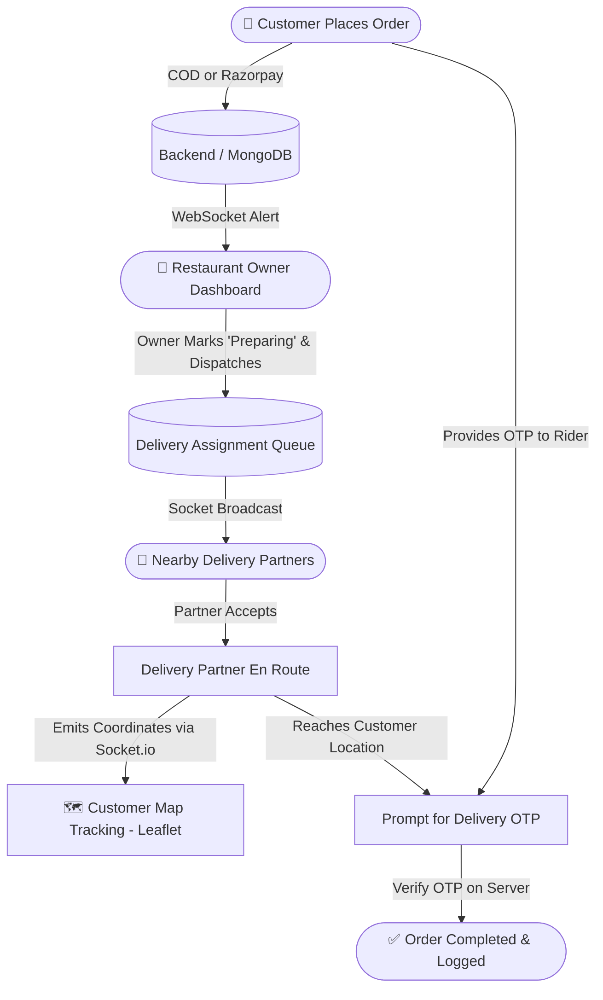
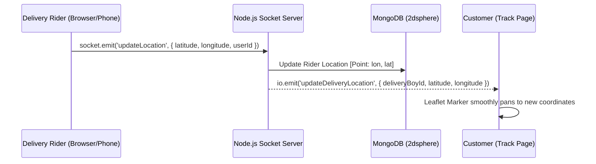

<div align="center">


<br/>

<a href="https://github.com/abhishek23027kushwaha/food_web_application">
  
</a>

<br/><br/>

[](https://github.com/abhishek23027kushwaha/food_web_application)
[](https://react.dev/)
[](https://nodejs.org/)
[](https://www.mongodb.com/)
[](https://socket.io/)

<br/>


<br/><br/>

### **🍕 Real-Time Multi-Vendor Food Ordering & Delivery Management Solution**

</div>

<br/>

<div align="center">

### 📊 At a Glance

<table width="100%">
<tr>
<td align="center" width="20%">👥 <b>User Roles</b><br/><h3>3 Distinct</h3><sub>Customer · Owner · Delivery Boy</sub></td>
<td align="center" width="20%">📍 <b>Live Tracking</b><br/><h3>Socket.io</h3><sub>Leaflet / OpenStreetMap</sub></td>
<td align="center" width="20%">💳 <b>Payments</b><br/><h3>Razorpay</h3><sub>COD + Online Gateway</sub></td>
<td align="center" width="20%">🔐 <b>Delivery Security</b><br/><h3>OTP Handover</h3><sub>Secure Verification Engine</sub></td>
<td align="center" width="20%">☁️ <b>Media Storage</b><br/><h3>Cloudinary</h3><sub>Menu & Shop Banner Uploads</sub></td>
</tr>
</table>

</div>

---

## 📖 Table of Contents

**🧭 Architecture & Concepts**

&nbsp;&nbsp;📌 [Overview](#-overview) &nbsp;·&nbsp; ✨ [Key Features](#-key-features) &nbsp;·&nbsp; 🔄 [Real-Time Workflow & Architecture](#-real-time-workflow--architecture) &nbsp;·&nbsp; 🎭 [Role-Based Access Control](#-role-based-access-control)

**🛠️ Engineering & Development**

&nbsp;&nbsp;🧰 [Tech Stack](#-tech-stack) &nbsp;·&nbsp; 📁 [Project Structure](#-project-structure) &nbsp;·&nbsp; 🚀 [Getting Started](#-getting-started) &nbsp;·&nbsp; 🔑 [Environment Variables](#-environment-variables) &nbsp;·&nbsp; 📡 [API Endpoints](#-api-endpoints)

**🛡️ Security & Delivery**

&nbsp;&nbsp;🔒 [Security & Verification](#-security--verification) &nbsp;·&nbsp; 🤝 [Contributing](#-contributing) &nbsp;·&nbsp; 📬 [Author & Contact](#-author--contact)

---

## 📌 Overview

**FoodDelivery App** is an enterprise-grade full-stack food delivery application built using the **MERN Stack** (MongoDB, Express, React 19, Node.js) paired with **Socket.io** for real-time location streaming and **Redux Toolkit** for state management.

The platform provides a complete three-tier user experience:
1. **Customers**: Discover dishes & shops by current city, filter by dietary preferences, place orders via Cash on Delivery or Razorpay, and track delivery partners live on an interactive map.
2. **Restaurant Owners**: Register & manage restaurants, upload menus with Cloudinary-backed images, receive incoming orders instantly, update preparation stages, and assign delivery riders.
3. **Delivery Partners**: Receive automated proximity-based delivery assignments, navigate using real-time location coordinates, stream live GPS movements to customers, and execute OTP-secured order handovers.

<div align="right">

[⬆ back to top](#-table-of-contents)

</div>

---

## ✨ Key Features

<table width="100%">
<tr><td>

#### 👤 Customer Experience 

</td></tr>
<tr><td>✅ &nbsp; <b>Location Detection:</b> Reverse-geocoding via Geo API to show food and restaurants in the customer's city.</td></tr>
<tr><td>✅ &nbsp; <b>Smart Category & Search:</b> Filter by fast food, pizza, burgers, beverages, veg/non-veg, and top-rated cuisines.</td></tr>
<tr><td>✅ &nbsp; <b>Shopping Cart & Multi-Shop Checkout:</b> Optimized cart state with price breakdowns and delivery notes.</td></tr>
<tr><td>✅ &nbsp; <b>Secure Online Payments:</b> Seamless checkout via Razorpay alongside Cash on Delivery (COD).</td></tr>
<tr><td>✅ &nbsp; <b>Live Map Tracking:</b> Real-time visual tracking of delivery partners via Leaflet and OpenStreetMap.</td></tr>
<tr><td>✅ &nbsp; <b>Delivery OTP Verification:</b> 6-digit OTP delivery confirmation ensuring orders are delivered safely.</td></tr>

<tr><td>

#### 🍳 Restaurant Owner Dashboard 

</td></tr>
<tr><td>✅ &nbsp; <b>Storefront Setup:</b> Create and edit shop profiles with banners, cuisine types, operational hours, and address.</td></tr>
<tr><td>✅ &nbsp; <b>Menu & Inventory Management:</b> Add, edit, or remove menu items with high-resolution Cloudinary photo uploads.</td></tr>
<tr><td>✅ &nbsp; <b>Live Order Pipeline:</b> Real-time notification of new orders with state toggles: <code>Pending</code> ➔ <code>Preparing</code> ➔ <code>Out for Delivery</code> ➔ <code>Delivered</code>.</td></tr>
<tr><td>✅ &nbsp; <b>Automated Delivery Request:</b> One-click dispatch triggers assignment alerts to nearby delivery partners.</td></tr>

<tr><td>

#### 🛵 Delivery Partner Portal 

</td></tr>
<tr><td>✅ &nbsp; <b>Assignment Radar:</b> Receive instant notifications when a restaurant marks an order ready for pickup.</td></tr>
<tr><td>✅ &nbsp; <b>Geo-Location Broadcasting:</b> Background GPS coordinate emission over WebSockets to client map instances.</td></tr>
<tr><td>✅ &nbsp; <b>Order Handover Engine:</b> Secure customer OTP validation endpoint to complete delivery and log timestamps.</td></tr>
<tr><td>✅ &nbsp; <b>Earnings & Daily Summary:</b> Track completed daily drop-offs and active delivery assignments.</td></tr>

<tr><td>

#### 🔐 Authentication & Core System 

</td></tr>
<tr><td>✅ &nbsp; <b>Dual-Method Auth:</b> Standard JWT cookie-based email/password authentication + Firebase Google OAuth sign-in.</td></tr>
<tr><td>✅ &nbsp; <b>Password Recovery:</b> Nodemailer-powered 6-digit email OTP generation and expiration timers.</td></tr>
<tr><td>✅ &nbsp; <b>Geospatial Indexing:</b> MongoDB <code>2dsphere</code> indexing for ultra-fast location queries.</td></tr>
</table>

<div align="right">

[⬆ back to top](#-table-of-contents)

</div>

---

## 🔄 Real-Time Workflow & Architecture

### Complete Order Lifecycle



### Real-Time Live Tracking (Socket.io)



<div align="right">

[⬆ back to top](#-table-of-contents)

</div>

---

## 🎭 Role-Based Access Control

The platform enforces strict role-based authorization via JWT cookies and role validation middlewares:

<div align="center">

| Feature | 👤 User (Customer) | 🍳 Restaurant Owner | 🛵 Delivery Partner |
| :--- | :---: | :---: | :---: |
| Browse Shops & Food Items | ✅ | ✅ | ✅ |
| Add to Cart & Checkout | ✅ | ❌ | ❌ |
| Create & Manage Shop Profile | ❌ | ✅ | ❌ |
| Add / Modify Food Menu Items | ❌ | ✅ | ❌ |
| Manage Incoming Orders | ❌ | ✅ | ❌ |
| Accept Delivery Assignments | ❌ | ❌ | ✅ |
| Broadcast GPS Location | ❌ | ❌ | ✅ |
| Verify Delivery Handover OTP | ❌ | ❌ | ✅ |

</div>

<div align="right">

[⬆ back to top](#-table-of-contents)

</div>

---

## 🧰 Tech Stack

<div align="center">


</div>

<br/>

<table width="100%">
<tr><th align="left" width="22%">Layer</th><th align="left">Technologies Used</th></tr>
<tr><td>🎨 <b>Frontend UI</b></td><td><b>React 19</b>, <b>Vite</b>, <b>Tailwind CSS 4</b>, React Icons, React Spinners</td></tr>
<tr><td>📦 <b>State Management</b></td><td><b>Redux Toolkit</b> (User, Cart, Shop slices)</td></tr>
<tr><td>🗺️ <b>Maps & Tracking</b></td><td><b>Leaflet</b>, <b>React-Leaflet</b>, OpenStreetMap, Geoapify API</td></tr>
<tr><td>⚙️ <b>Backend Runtime</b></td><td><b>Node.js</b>, <b>Express 5</b>, <code>http</code> server</td></tr>
<tr><td>⚡ <b>Real-Time</b></td><td><b>Socket.io</b> & <b>Socket.io-client</b> (Bidirectional WebSocket events)</td></tr>
<tr><td>🗄️ <b>Database & ODM</b></td><td><b>MongoDB Atlas</b>, <b>Mongoose 8</b> (with <code>2dsphere</code> Geospatial Indexing)</td></tr>
<tr><td>💳 <b>Payment Gateway</b></td><td><b>Razorpay SDK</b> (Order generation & HMAC signature verification)</td></tr>
<tr><td>🖼️ <b>Media Storage</b></td><td><b>Cloudinary SDK</b> & <b>Multer</b> (Shop banners & dish images)</td></tr>
<tr><td>🔐 <b>Authentication & Mail</b></td><td><b>JWT</b>, <b>bcryptjs</b>, <b>Firebase Auth</b> (Google Sign-In), <b>Nodemailer</b></td></tr>
</table>

<div align="right">

[⬆ back to top](#-table-of-contents)

</div>

---

## 📁 Project Structure

```
food_delivery/
├── backend/
│   ├── config/
│   │   ├── db.js                     # MongoDB connection with Mongoose
│   │   └── cloudinary.js             # Cloudinary configuration
│   ├── controllers/
│   │   ├── auth.controllers.js       # Signup, Login, OTP verification, Google OAuth
│   │   ├── user.controllers.js       # User profile & location updater
│   │   ├── shop.controllers.js       # Shop registration, update & discovery
│   │   ├── item.controllers.js       # Menu item CRUD & media uploads
│   │   └── order.controllers.js      # Order processing, Razorpay & delivery logic
│   ├── middlewares/
│   │   ├── isAuth.js                 # JWT cookie validation middleware
│   │   └── multer.js                 # File upload buffer handler
│   ├── models/
│   │   ├── user.model.js             # User schema (roles, socketId, 2dsphere location)
│   │   ├── shop.model.js             # Shop schema with coordinates & categories
│   │   ├── item.model.js             # Food items with price, rating & Cloudinary URL
│   │   ├── order.model.js            # Composite orders, sub-orders, OTP & status
│   │   └── deliveryAssignment.model.js # Rider allocation & assignment status
│   ├── routes/
│   │   ├── auth.routes.js
│   │   ├── user.routes.js
│   │   ├── shop.routes.js
│   │   ├── item.routes.js
│   │   └── order.routes.js
│   ├── socket.js                     # Socket.io connection & real-time GPS relays
│   └── index.js                      # Express server entry point & HTTP/WS boot
├── frontend/
│   ├── public/
│   ├── src/
│   │   ├── assets/                   # Static icons & vectors
│   │   ├── components/
│   │   │   ├── Nav.jsx               # Navigation bar with role badges & cart count
│   │   │   ├── FoodCard.jsx          # Food card with add-to-cart action
│   │   │   ├── CategoryCard.jsx      # Food category selector
│   │   │   ├── CartItemCard.jsx      # Interactive cart adjustments
│   │   │   ├── UserDashboard.jsx     # Customer home & restaurant explorer
│   │   │   ├── OwnerDashboard.jsx    # Restaurant metrics & order pipeline
│   │   │   ├── DeliveryBoy.jsx       # Rider assignment feed & navigation
│   │   │   └── DeliveryBoyTracking.jsx # Live map tracking component
│   │   ├── hooks/                    # Custom queries (useGetCurrentUser, useGetCity, etc.)
│   │   ├── pages/
│   │   │   ├── SignIn.jsx & SignUp.jsx
│   │   │   ├── Home.jsx              # Role-aware conditional landing router
│   │   │   ├── CartPage.jsx & CheckOut.jsx
│   │   │   ├── TrackOrderPage.jsx    # Live map view of the dispatched rider
│   │   │   ├── MyOrders.jsx          # Order history & review receipts
│   │   │   └── CreateEditShop.jsx    # Owner storefront manager
│   │   ├── redux/                    # Redux store & state slices
│   │   ├── firebase.js               # Firebase Client App & Google Auth Provider
│   │   └── App.jsx                   # React Router route registry & Socket listener
│   └── package.json
└── README.md
```

<div align="right">

[⬆ back to top](#-table-of-contents)

</div>

---

## 🚀 Getting Started

### 📋 Prerequisites
- **Node.js** (v18.0 or higher)
- **MongoDB** (Local instance or MongoDB Atlas cluster)
- **Cloudinary** Account (for cloud image hosting)
- **Razorpay** Account (Test API keys for payments)
- **Firebase** Project (for Google OAuth)

---

### 1️⃣ Clone the Repository
```bash
git clone https://github.com/abhishek23027kushwaha/food_web_application.git
cd food_web_application
```

---

### 2️⃣ Backend Configuration

Navigate to the backend directory and install dependencies:
```bash
cd backend
npm install
```

Create a `.env` file inside `backend/`:
```env
PORT=8000
MONGODB_URL=mongodb+srv://<username>:<password>@cluster0.mongodb.net/food_delivery
JWT_SECRET=your_super_secret_jwt_key

# Nodemailer credentials for OTP password resets
EMAIL=your_email@gmail.com
PASS=your_gmail_app_password

# Cloudinary credentials for menu & shop pictures
CLOUDINARY_CLOUD_NAME=your_cloudinary_name
CLOUDINARY_API_KEY=your_cloudinary_api_key
CLOUDINARY_API_SECRET=your_cloudinary_api_secret

# Razorpay credentials for payment gateway
RAZORPAY_KEY_ID=your_razorpay_key_id
RAZORPAY_KEY_SECRET=your_razorpay_key_secret
```

Start the backend server:
```bash
npm run dev
```
> The backend server will start on `http://localhost:8000` with WebSocket listeners active.

---

### 3️⃣ Frontend Configuration

Open a second terminal window and navigate to `frontend/`:
```bash
cd frontend
npm install
```

Create a `.env` file inside `frontend/`:
```env
VITE_FIREBASE_APIKEY=your_firebase_api_key
VITE_GEOAPIKEY=your_geoapify_or_reverse_geocode_key
VITE_RAZORPAY_KEY_ID=your_razorpay_test_key_id
```

Run the frontend development server:
```bash
npm run dev
```
> The React app will run at `http://localhost:5173`.

<div align="right">

[⬆ back to top](#-table-of-contents)

</div>

---

## 📡 API Endpoints

### 🔐 Authentication (`/api/auth`)
| Method | Endpoint | Description |
| :---: | :--- | :--- |
| `POST` | `/api/auth/signup` | Register a new account (`user`, `owner`, or `deliveryBoy`) |
| `POST` | `/api/auth/signin` | Log in and receive HTTP-only JWT cookie |
| `GET` | `/api/auth/signout` | Clear user session & cookie |
| `POST` | `/api/auth/send-otp` | Trigger 6-digit OTP email for password reset |
| `POST` | `/api/auth/verify-otp` | Verify validity of sent OTP |
| `POST` | `/api/auth/reset-password` | Set new password upon successful OTP validation |
| `POST` | `/api/auth/google-auth` | Authenticate or register using Firebase Google token |

### 🏪 Shop & Storefront (`/api/shop`)
| Method | Endpoint | Description |
| :---: | :--- | :--- |
| `POST` | `/api/shop/create-edit` | Create or update owner's restaurant profile |
| `GET` | `/api/shop/get-my-shop` | Retrieve current owner's registered shop |
| `GET` | `/api/shop/get-shops-by-city/:city` | Get all available restaurants in a selected city |
| `GET` | `/api/shop/:shopId` | Fetch restaurant details and full menu |

### 🍔 Menu Items (`/api/item`)
| Method | Endpoint | Description |
| :---: | :--- | :--- |
| `POST` | `/api/item/add-item` | Add menu item with Cloudinary image upload |
| `POST` | `/api/item/edit-item/:itemId` | Update dish details, price, or description |
| `DELETE` | `/api/item/delete/:itemId` | Remove an item from the menu |
| `GET` | `/api/item/get-items-by-city/:city` | Retrieve curated dishes available in target city |

### 📦 Orders & Delivery Operations (`/api/order`)
| Method | Endpoint | Description |
| :---: | :--- | :--- |
| `POST` | `/api/order/place-order` | Create order (handles COD or Razorpay initialization) |
| `POST` | `/api/order/verify-payment` | Validate Razorpay signature and mark order paid |
| `GET` | `/api/order/my-orders` | Fetch customer purchase history or owner order feed |
| `POST` | `/api/order/update-status/:orderId/:shopId` | Update preparation stage (`preparing`, etc.) |
| `GET` | `/api/order/get-assignments` | Fetch nearby delivery requests for delivery riders |
| `GET` | `/api/order/accept-order/:assignmentId` | Assign rider to order and update status |
| `POST` | `/api/order/send-delivery-otp` | Dispatch secure delivery OTP to customer |
| `POST` | `/api/order/verify-delivery-otp` | Validate rider-entered OTP and complete delivery |
| `GET` | `/api/order/get-order-by-id/:orderId` | Query order details for live tracking |

<div align="right">

[⬆ back to top](#-table-of-contents)

</div>

---

## 🔒 Security & Verification

- **Secure Password Hashing:** Uses `bcryptjs` with salt rounds to store encrypted credentials.
- **HTTP-Only Cookies:** Tokens are passed via `httpOnly` secure cookies to mitigate Cross-Site Scripting (XSS).
- **Payment Verification via HMAC:** Razorpay webhooks and payment confirmations verify crypto signatures on the server before marking orders as paid.
- **Server-Side OTP Handover:** Delivery handovers cannot be closed by client manipulation; completion requires matching server-stored delivery OTPs.
- **Geospatial Query Protection:** MongoDB 2dsphere indexes prevent coordinate tampering and guarantee localized querying.

<div align="right">

[⬆ back to top](#-table-of-contents)

</div>

---

## 🤝 Contributing

Contributions are what make the open-source community such an amazing place to learn, inspire, and create. Any contributions you make are **greatly appreciated**.

1. Fork the Project
2. Create your Feature Branch (`git checkout -b feature/AmazingFeature`)
3. Commit your Changes (`git commit -m 'Add some AmazingFeature'`)
4. Push to the Branch (`git push origin feature/AmazingFeature`)
5. Open a Pull Request

---

## 📬 Author & Contact

<div align="center">

**Abhishek Kushwaha**

[](mailto:abhishek8888raj@gmail.com)
[](https://github.com/abhishek23027kushwaha)

⭐ **If you find this project useful, don't forget to give it a star on GitHub!** ⭐


</div>
